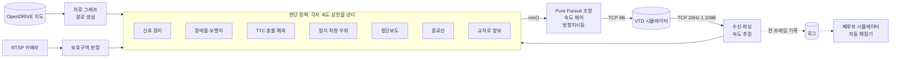

# HL FMA 2026 자율주행 경진대회 (시뮬레이션 부문)

상용 자율주행 시뮬레이터 **VTD** 위에서, 대회 당일 받는 대략적 경로 좌표를 전달받고 **교통법규 15개 항목을 지키며 완주**하는 자율주행 제어기를 개발했고, 최우수상을 입상했습니다.
문서 없는 통신 규격 해석부터 지도 기반 경로 생성, 판단·제어 로직, 검증 도구까지 처음부터 만들어 나갔습니다.

**결과: 본대회 완주, 입상** ([최우수상])

| | |
|---|---|
| 기간 | 2026.08.23 ~ 09.12 (약 3주) + 대회 후 사고 분석·개선 |
| 형태 | 개인 참가 |
| 언어 | Python 3.11, **표준 라이브러리만** (대회 PC에서 numpy 실행 차단) |
| 환경 | VTD 2025.2 (Ubuntu 24.04) ↔ 제어기 PC (Windows), 이더넷 직결 |
| 인터페이스 | TCP 20Hz (수신 1,109B / 송신 9B), RTSP 카메라, OpenDRIVE 지도 |

https://github.com/user-attachments/assets/6d5ad0bb-0357-46de-b801-33793639df9f

## 내 역할

개인 참가로 전 과정을 수행했습니다.

- **통신 역공학:** 바이트 덤프로 1,109바이트 프레임 구조, 단위, 조향 부호 확정
- **지도·경로:** OpenDRIVE 파서와 차로 연결 그래프(도로 651, 교차로 94, 차로 2,471), 다익스트라 경로 탐색
- **판단·제어:** Pure Pursuit 추종, 신호 정지, 충돌 회피·TTC 예측, 정지 차량 우회, 카메라 보호구역 판정, 방향지시등, 횡단보도, 종료선 판정
- **검증:** 폐루프 시뮬레이터, 자동 채점기, 실차(VTD) 시험 설계와 로그 분석
- **대회 운영:** 15분 안에 끝내는 당일 절차 설계와 리허설

AI 코딩 에이전트(Claude Code)와 협업했습니다. 요구사항, 설계 결정, 검증 기준은 제가 정하고 에이전트의 계획서를 검토·승인했습니다. 결과는 로그와 실차로 직접 검증했습니다.

## 구조

판단 모듈은 입출력 없는 순수 로직으로 만들고, 모두 같은 형태(제곱근 감속 프로파일)의 **속도 상한**을 내게 해 `min()` 하나로 합쳤습니다. 모듈마다 끄는 옵션이 있어 문제를 하나씩 분리할 수 있습니다.

## 주요 성과

| 항목 | 개선 |
|---|---|
| 속도 추정 (도착 지터 원인 규명) | 응답 1,050 → 200ms, 진동 0.042 → 0.011km/h |
| 경로 생성 (수동 녹화 대체) | 좌표 입력 → 수 초 내 생성. 녹화 실측 825m 대비 825.8m |
| 차로 중심선 정확도 | 오차 중앙값 3.32m → 0.11m |
| 적색 신호 통과 | 8회 → 0회 (사전테스트 6세션 기준) |
| 충돌 (시뮬레이션) | 4회 → 0회 |
| 정지 차량 6대 시나리오 | 306.9초 → 207.5초 (우회 경로 재탐색) |
| 종료선 | 6m 미달 → +9.4m 통과 (라바콘 기하 탐지) |
| 방향지시등 미점등 | 0/26 |
| 대회 후 교차로 충돌 재현 | 3/4/1건 → 0/0/0건 |

## 트러블슈팅 하이라이트

- **속도가 흔들린 진짜 이유:** 위치 노이즈가 아니라 40/80ms 도착 지터였습니다. 측정 시간 대신 공칭 시간(20Hz 고정 스텝)을 쓰도록 바꿨습니다.
- **종료선 6m 앞 정지:** 경로 좌표 오차, 정지선 누락 버그, 완주 판정 결함의 세 원인을 분리하고 3중 방어로 해결했습니다.
- **보정 장치가 숨긴 버그:** 방향지시등 오점등을 가리던 보정 로직 뒤에 지도 생성기의 차로변경 방향 부호 버그가 있었습니다.
- **지도에 없는 보호구역:** 지도 전수조사로 붉은 노면 정보가 없음을 확인하고, 카메라 붉은 픽셀 비율로 판정했습니다(학습 모델 없이 순수 파이썬).
- **대회 교차로 충돌:** 회전 차량 직선 예측, 정지 중 예측 해제, 진입 판단 부재가 원인이었습니다. 녹화 재생으로 재현한 뒤 교차로 진입 양보 게이트로 해결했고, 실차 재검증에서 남은 한계 3가지를 규명했습니다.

## 검증 방법

1. **전 프레임 기록**: 수신 원본, 제어 상태, 객체, 이벤트
2. **폐루프 시뮬레이터**: 가짜 VTD 서버 + 자전거 모델, 신호 위상 재생, 이동 객체 주입, 녹화 NPC 재생
3. **자동 채점기**: 적색 통과, 충돌(차체 간격), 방향지시등 선행 시간, 횡단보도 정차, 보호구역 진입·이탈 시점
4. **회귀 시험**: 기능 추가마다 빈 도로와 기존 시나리오 전체 재실행
5. **실차(VTD) 시험**: 사전테스트, 직접 만든 시나리오

## 한계와 다음 단계

- 교차로 양보의 통과 시간을 실제 곡률 속도 프로파일로 계산
- 진입로에 정지한 차량의 출발 가능성 예측
- 교차로 안에서 정지가 불가능할 때 상대 궤적을 빠져나가는 판단
- 반응형 NPC를 포함한 시뮬레이션 검증

> 대회 제공 자료(지도 파일, 매뉴얼, 시나리오)는 재배포하지 않습니다.
